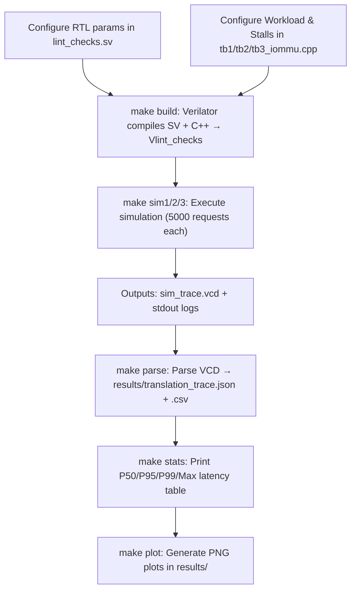

# Simulation Workflow & Methodology

This document outlines the high-level flow of running micro-architectural contention experiments in the `TempoIOMMU-RV` environment. It describes how hardware and testbench parameters are configured, and how a complete simulation cycle executes from compilation to data visualization.

---

## 1. Parameterization & Configuration

Before running an experiment, you configure two distinct sets of parameters: **Hardware Parameters** and **Testbench Parameters**.

### Hardware Parameters (RTL Configuration)
The structural capacities of the IOMMU (such as cache sizes) are configured when instantiating the module.
- **File**: `lint_checks.sv` (The top-level wrapper used for Verilator simulation).
- **Key Parameters**:
  - `IOTLB_ENTRIES`: Sets the size of the I/O Translation Lookaside Buffer.
  - `DDTC_ENTRIES`: Sets the size of the Device Directory Table Cache.
- **Example**: Changing `DDTC_ENTRIES` to `4` forces cache thrashing when 5 or more devices are active.

### Testbench Parameters (Workload & Contention Modeling)
The traffic patterns and interconnect behaviors are modeled in software across three separate testbenches:

| Testbench | Experiment | Requests | Memory Model |
|-----------|------------|----------|--------------|
| [`tb1_iommu.cpp`](../tb1_iommu.cpp) | Exp 1: IOTLB Thrashing | 5,000 | Fixed 3-cycle latency |
| [`tb2_iommu.cpp`](../tb2_iommu.cpp) | Exp 2: DDTC Contention | 5,000 | Fixed 3-cycle latency |
| [`tb3_iommu.cpp`](../tb3_iommu.cpp) | Exp 3: Interconnect Stalls | 5,000 | Randomized stall (5–50 cycles) |

**Key Testbench Parameters**:
- **`exp_stage` request count**: All testbenches are configured to run **5,000 requests** before halting simulation.
- **AXI ID rotation**: All testbenches use `exp_stage % 8` as the AXI transaction ID to prevent the internal AXI demux ID counters from reaching their limit (`ar_id_cnt_full`). This is critical for sustaining thousands of back-to-back transactions.
- **Memory Contention Model**: Exp 3 uses a `RandomStalledMemoryModel` which injects a random stall of 5–50 cycles on each AXI response to simulate background interconnect congestion.

---

## 2. Compilation (`make build`)

Once parameters are set, the project is compiled into an executable binary.
- We use **Verilator** to transpile the SystemVerilog RTL (e.g., `riscv_iommu.sv` and its sub-modules) into C++ models.
- Verilator links the generated hardware models with the testbench C++ file to create a fast, cycle-accurate binary `Vlint_checks` inside the `obj_dir/` directory.

```bash
make build
```

> **Note**: Only needs to be run once, or after any change to `.sv` or `.cpp` source files.

---

## 3. Running Experiments

Each experiment has its own `make` target that runs the full pipeline (simulation → parse → stats → plot) automatically:

### Run a complete experiment end-to-end:
```bash
make exp1    # Experiment 1: IOTLB Capacity Thrashing (tb1_iommu.cpp, 5000 reqs)
make exp2    # Experiment 2: Multi-Device DDTC Contention (tb2_iommu.cpp, 5000 reqs)
make exp3    # Experiment 3: Interconnect Memory Stalls (tb3_iommu.cpp, 5000 reqs)
```

### Run individual steps:
```bash
make sim1    # Run Exp 1 simulation binary only  (writes sim_trace.vcd)
make sim2    # Run Exp 2 simulation binary only
make sim3    # Run Exp 3 simulation binary only
make parse   # Parse sim_trace.vcd → results/translation_trace.json + .csv
make stats   # Compute mean/P50/P95/P99/max latency statistics (prints to terminal)
make plot    # Generate PNG plots in results/
```

---

## 4. Execution Flow

Running the simulation binary launches the following pipeline:

1. **Initialization**: The C++ testbench resets the hardware, toggles the clock (`clk_i`), and populates the memory model's internal data structures with mocked RISC-V Sv39 Page Tables and Device Contexts.
2. **Workload Injection**: The testbench asserts AXI translation requests (`dev_tr_req_i`) acting as upstream peripheral devices. Dynamic AXI IDs (`exp_stage % 8`) are used to prevent demux counter overflow across thousands of transactions.
3. **Execution & Tracing**: The hardware IOMMU processes the translations. On a cache miss, the IOMMU acts as an AXI master, sending read requests (`ds_req_o`) back to the testbench's memory model to perform Page Table or Device Directory walks.
4. **Memory Response**: The memory model drives `ds_resp_i` with translation data — either immediately (Exp 1 & 2) or after a random stall (Exp 3). Device completion responses are driven on `dev_comp_resp_i`.
5. **VCD Tracing**: All signal transitions are captured to `sim_trace.vcd` for post-processing.

---

## 5. Trace Parsing & Statistics (`make parse` & `make stats`)

After the simulation finishes, the raw VCD signal trace is decoded.
- `scripts/parse_vcd.py` reads `sim_trace.vcd` and extracts per-transaction data:
  - Start cycle (when `ar_valid` was asserted for the device translation request)
  - Completion cycle (when `r_valid` rises on the completion channel)
  - IOTLB hit/miss, DDT walk, Stage-1/Stage-2 PTW flags
  - Physical address and AXI response code (success/error)
- Outputs are saved to `results/translation_trace.json` and `results/translation_trace.csv`.
- `scripts/calc_stats.py` computes: **Mean**, **P50**, **P95**, **P99**, **Max** latency per category.

---

## 6. Visualization (`make plot`)

`scripts/plot_latency.py` consumes the CSV trace to generate visual figures using `matplotlib`:

| Plot | Description |
|------|-------------|
| `results/latency_by_request.png` | Timeline of latency per request — shows spikes and trends at scale |
| `results/latency_distribution.png` | Histogram of latency frequency — reveals whether variance is deterministic or stochastic |
| `results/latency_hit_vs_miss.png` | Boxplot comparing IOTLB hit vs. miss latency distributions |

---

## 7. Summary Flowchart


